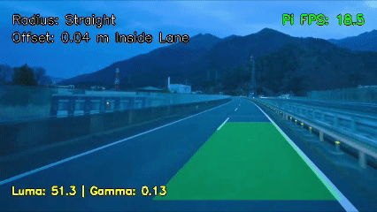

# 🚗 Hệ Thống Cảnh Báo Lệch Làn Đường (LDW - Lane Departure Warning)

Dự án xây dựng hệ thống **Cảnh báo lệch làn đường (Lane Departure Warning - LDW)** theo thời gian thực sử dụng các thuật toán Xử lý ảnh truyền thống (Classical Computer Vision), được tối ưu hóa để hoạt động mượt mà trên cả máy tính cá nhân (PC) và máy tính nhúng **Raspberry Pi** (kiến trúc đa luồng).

---

## ✨ Tính năng nổi bật

* **Thích nghi đa điều kiện ánh sáng:** Tự động đo độ sáng mặt đường (Luma) và nội suy hệ số **Adaptive Gamma Correction** kết hợp cân bằng sáng cục bộ **CLAHE** trên không gian màu LAB và lọc hình thái học (Morphological Filtering).
* **Vùng quan tâm động (Dynamic ROI):** Tự động phát hiện và bám theo **Điểm tụ (Vanishing Point)** bằng biến đổi Hough (Hough Transform) và bộ lọc làm mượt thích nghi, giúp vùng ROI tự động xoay/nghiêng theo khúc cua hoặc độ dốc mặt đường.
* **Góc nhìn chim bay (Bird's Eye View - BEV):** Áp dụng biến đổi phối cảnh (Inverse Perspective Mapping) đưa làn đường về dạng song song để đo đạc hình học chính xác.
* **Nội suy và bám vết làn đường chống nhiễu:** 
  * Kết hợp **Spatial Histogram**, **Sliding Window** và **Search Around Poly** để tăng tốc độ trích xuất điểm ảnh.
  * Sử dụng thuật toán **RANSAC (Random Sample Consensus)** kết hợp lấy mẫu thưa để tìm đa thức bậc 2 chuẩn xác, loại bỏ hoàn toàn các điểm nhiễu (vệt nắng, bóng cây, mũi tên chỉ đường).
  * Bộ đệm **LaneTracker** làm mượt đường cong qua nhiều khung hình và tự động phát hiện trạng thái chuyển làn.
* **Cảnh báo thông minh (HUD & Warning Hold):** Tính toán bán kính cong thực tế (mét), độ lệch tâm xe so với giữa làn (mét) và duy trì cảnh báo thị giác khi phát hiện xe đè vạch.
* **Tối ưu hóa cho hệ thống nhúng (Raspberry Pi):** Kiến trúc **3 luồng độc lập (Producer - Consumer)** tách biệt hoàn toàn tác vụ Đọc Video, Xử lý Thuật toán và Ghi Video/Log CSV, giúp triệt tiêu nghẽn cổ chai I/O.

---

## 🛠️ Quy trình thuật toán (Pipeline Architecture)

Hệ thống được chia thành 6 bước xử lý tuần tự trong thư mục `pipeline/`:

1. **`step1_preprocessing.py`**: Chuyển đổi ảnh đầu vào (`640x360`), tự động chỉnh sáng Gamma vùng mặt đường, tách kênh `L` (LAB), tăng tương phản CLAHE, phân ngưỡng thích nghi (Adaptive Threshold) và khử nhiễu ngang/dọc bằng Morphology.
2. **`step2_dynamic_roi.py`**: Lọc biên Canny trong vùng mặt nạ cơ sở, tìm đoạn thẳng bằng `HoughLinesP`, phân loại vạch trái/phải theo độ dốc để tìm giao điểm (Vanishing Point) và dựng hình thang Dynamic ROI.
3. **`step3_birdseye_view.py`**: Chiếu phối cảnh vùng Dynamic ROI sang ảnh phẳng từ trên xuống (BEV) và lưu ma trận nghịch đảo `Minv`.
4. **`step4_5_lane_detection.py`**: Quét cửa sổ trượt (hoặc tìm kiếm quanh đa thức cũ nếu đã khóa mục tiêu), khớp đường cong bậc hai bằng RANSAC và làm mượt qua `LaneTracker`.
5. **`step6_display.py`**: Quy đổi từ đơn vị pixel sang mét thực tế, tính bán kính cong, khoảng cách lệch tâm và chiếu ngược vùng làn đường về góc nhìn camera gốc.

---
Cần thêm các video để test, hãy truy cập vào link sau: https://drive.google.com/drive/u/0/folders/1UWewQTCyxKDvsnVRkl_zQIcmTD8WyAzz